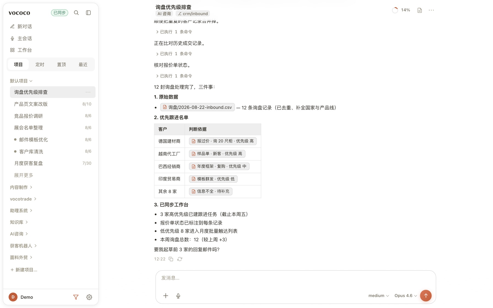
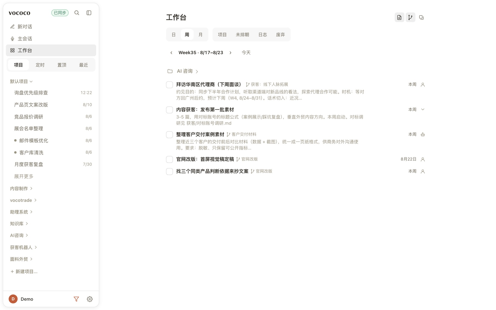
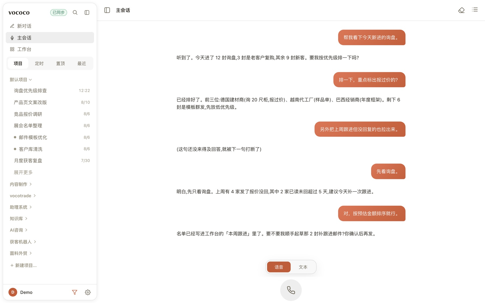
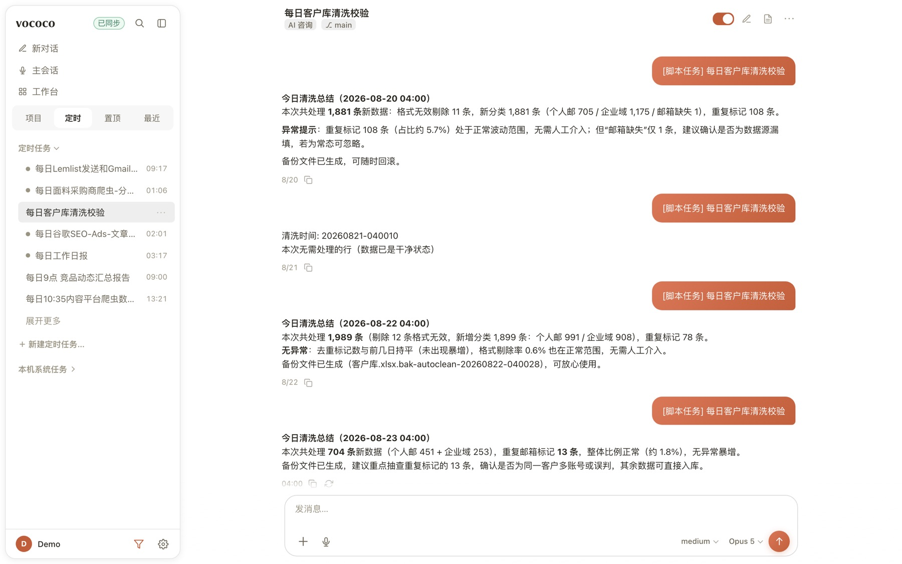

<p align="center">
  
</p>

<h1 align="center">vococo</h1>

<p align="center">
  基于 <b>Claude 订阅</b> 的个人 AI 助理，单用户、常驻、语音优先、多渠道共用一个大脑。
</p>

<p align="center">
  
  
  
</p>

---

## 截图

| 聊天 · 工具调用 | 工作台 |
|:---:|:---:|
|  |  |
| **语音对话** | **定时任务** |
|  |  |

---

> 完整需求与验收标准见 [REQUIREMENTS.md](REQUIREMENTS.md)。

## 特性

- **多渠道，一个会话** — TUI / CLI / Web（自建 PWA，手机浏览器直达）；全端共享同一主会话
- **Web 自建 UI** — 多会话侧边栏、工具调用卡片、模型面板 + 限额环、设置页全在线改
- **语音优先** — 按住说话（STT）、TTS 朗读、Omni 实时免提通话（可打断）
- **后台任务引擎** — 语音派活 / cron / 独立新会话共用一套引擎，代码任务跑在独立 git worktree
- **Agent 分层委托** — 持久 Agent 间创建普通独立会话，可继续追问；自动派单两层/五任务与可靠回执，不等于同步子代理
- **长期记忆** — 启动注入 `~/AI_BRAIN`；`save_memory` 沉淀、`recall_past` 召回，纯 Markdown
- **多供应商热切换** — DeepSeek / Kimi / 任意 Anthropic 兼容中转，设置页添加即生效
- **运行数据面板** — 设置页「数据」:工作强度日历、各模型用量与花费、缓存命中/工具成功率，逐个会话可下钻
- **安全模型 + 自我运维** — 危险三档闸、手机审批；`vococo doctor` 自检、`restart_self` 安全重启、看门狗防假死

## 业务文件隔离

Agent 的 `workdir` 保留项目身份及规则来源；`execution_mode=workspace` 时，从仓库外
`~/vococo-workspaces/<id>/` 运行，正式成果写 `output_dir`（默认原 workdir，可为 iCloud）。
iCloud/非 Git 目录默认 workspace，开发 Git 项目默认 project；总助理不变。
业务文件工具限制可写目录，Bash/同步子代理继承系统文件沙箱，禁止关闭；Agent 配置不可自改。
成果目录和可写关联不得位于 Git 仓库，iCloud 失败明确报错，不自动改存源码目录。
业务 Agent 可在「设置 → 代码仓库」绑定多个 Git 根目录（`repositories`）。每会话自动在
`~/vococo-workspaces/.repositories/<agent>/<会话哈希>/<仓库哈希>/` 建独立克隆与分支，
不共享 Git 元数据；原仓库只读。修改、构建和本地提交均使用提示词提供的副本路径，推送/发布保留原有审批。
副本不含未提交修改、忽略的 `.env` 或依赖，不自动拉取远端；取消绑定从下一轮生效，
不强行中断当前命令、不删除已有副本。初始化可用 `scripts/bind_business_repositories.py
--data-dir /实际/data目录 --bind AGENT_ID=/仓库根目录`，默认预览，`--apply` 备份配置并准备主会话副本。
业务会话不能自行注册/切换 MCP 或创建/修改未沙箱化的脚本 cron；已配置 MCP 与已有固定脚本是主人管理的受信任自动化，不受这次 Bash 沙箱保护。固定脚本保持原目录。

迁移先预览，带 `--apply` 才更新并备份；不会移动历史产物或修改固定脚本：
```sh
uv run python scripts/migrate_business_workspaces.py --data-dir /实际/data目录
# 单个嵌套技能 Agent 可另指定仓库外成果目录：--workspace-agent ID=/绝对/iCloud目录
```
网络兼容：已有无认证本机 HTTP 代理（`http_proxy`/`HTTP_PROXY`，其次 HTTPS 对应变量）复用原端口；
普通 `ssh`（包括 Python 子进程调用）自动使用 SDK SOCKS 代理，文件隔离保持不变。
`sshpass -p 密码 ssh …` / `sshpass -e ssh …` 在业务空间改用 OpenSSH 密码助手，
不创建沙箱禁止的伪终端，也不写密码文件；其他 sshpass 参数明确报不支持。
不放开全部本机端口；显式 `/usr/bin/ssh` 或自行覆盖 PATH 的脚本需要自行使用 SDK 的代理参数。

飞书文档使用内置 `lark_document`（fetch/create/update），由宿主官方 CLI 管理凭据续期与
Keychain/DPoP/TLS，不在业务 Bash 内运行 `lark-cli`，不关闭沙箱或证书验证。
写入必须审批，仅接受纯 Markdown 正文；不接收本机路径、XML/HTML、图片或附件，
不支持表格、权限管理或登录。调用串行，取消回收自有子进程组；超时不自动重试写入。
读取受 CLI 自身文档权限限制，宿主代理不是每个 Agent 独立的飞书账号隔离。
旧会话若仍直接执行 `lark-cli docs +fetch/+create/+update`，业务钩子在执行前拒绝并明确提示
改用 `mcp__vococo__lark_document`，不再等 TLS 失败后让用户手动重试；本地技能阅读、校验及开发会话不受影响。

离线命令级验收（本机假模型，不使用真实模型额度）：
- `uv run python eval/check_business_sandbox.py`：文件写入边界。
- `uv run python eval/check_business_network.py`：显式 HTTP 代理、sshpass→SSH 握手与文件写入边界（不代表真实密码认证已验收）。
- `uv run python eval/check_lark_documents.py 文档token`：真实 SDK 业务沙箱经 MCP 宿主代理读取现有飞书目录（使用本机授权，只读联网；不强制刷新或创建文档）。加 `--legacy-first` 可验证旧命令拒绝提示及后续 MCP 读取（本机脚本模型按预定步骤调用，不代表已验证真实模型的自主选择）。

## 架构

```
vococo/__main__.py     CLI 入口:tui / chat / serve / cron / doctor
core/                  agent 循环(claude-agent-sdk)· client 保温池 · prompt 组装
                       · 每会话 git worktree 隔离 · 后台任务引擎(task_runner)
gateway/               平台内核(命令注册表 / converse / 会话路由)
  ├─ adapters/web        自建 PWA(SSE 流式 / 多会话 / 设置页)
  ├─ adapters/web_push   VAPID Web Push 系统通知
  ├─ settings_store.py   设置页存储(供应商/模型/skill/MCP/effort)
  └─ stats.py            运行数据面板:日志增量 ETL(stats.db)+ 用量/花费/会话聚合
cron/                  cron / interval / once 调度 + 自动化建议(consent-first)
memory/                SQLite 会话库(state.db)+ 检索 + 图片/音频/视频附件
tools/                 内置 MCP server(记忆/定时/发消息/自我重启…)
                       + danger.py(灾难拦截 + 审批闸 PreToolUse hook)
tui/                   rich/prompt_toolkit 流式 TUI(工具过程 + Markdown)
voice/                 语音:STT 转写 · TTS 朗读 · Omni 免提实时通话
plugin/                内置 skill 插件(只给 vococo 自己用,如 vococo-web-publish)
deploy/                run.sh 守护循环(崩溃自启)/ stop / restart / launchd
```

## 入口

```bash
vococo            # 默认进 TUI
vococo chat       # 纯文本对话(调试 fallback)
vococo serve      # 常驻:Web + 调度器(heartbeat/主动推送)
vococo cron       # 列出定时任务
vococo doctor     # 自检:配置/认证/DB/AI_BRAIN/进程
```

Web 入口:`serve` 时设 `WEB_ENABLED=1` 即在同进程起网页服务(默认只听 `127.0.0.1:8848`),
配合 Cloudflare Tunnel / Tailscale 暴露到公网即得手机 PWA(走公网必设 `WEB_AUTH_TOKEN`)。

## 快捷命令(TUI/Web 通用)

`/new` 开新会话(旧史保留) · `/clear` 清屏+开新 · `/model [名]` 切模型 · `/history` 看历史 · `/status` 会话信息 · `/suggest` 看/接受自动化建议 · `/help`

## 多供应商切换

想用 **DeepSeek / Kimi** 或任意第三方 Anthropic 兼容中转:在 Web 设置页的「模型」
管理界面直接添加(base_url + key + model),**每轮自动生效,无需重启**;会话里
`/model <模型名>` 可临时覆盖。只用第三方时,`.env` 里的订阅 token 可留空。
认证细节见 [REQUIREMENTS.md](REQUIREMENTS.md) §6。

## Agent 分层委托

委托只是普通独立会话的来源关系，不是新会话种类，也不是一次性只读任务。
接单后使用普通 `chat` task 路径；用户可以在原会话继续、追问和重试，历史不清空。

| 工具（内置 `vococo` MCP） | 用途 |
|---|---|
| `list_delegate_agents` | 列出 ID/名称；重名时用唯一 ID |
| `delegate_to_agent` | 必填 `agent`、`title`、`prompt`；来源身份由服务端绑定 |
| `get_agent_delegation` | 按任务 ID 查询状态、完整结果和本轮回执投递状态 |

- **正常执行**：加载目标 Agent 自己的资料、记忆、技能、MCP 和工具，不继承目标主会话历史。
  Git 项目使用普通独立 worktree；非 Git 目录直接使用普通任务目录。模型沿用来源选择。
  超时、token、轮数、排队、取消和重启恢复均遵循普通任务设置。
- **自动链限制**：最多两层、同链累计五个子任务，禁止回到祖先（含自己）；更换自动派发
  入口不能重置链路。真人在原会话开新轮次不受旧 depth 限制，可重新发起一条自动链。
- **权限**：自动执行只继承服务端绑定的来源身份、显式禁用工具和审批档位，不复制来源的
  MCP/hooks/skills 配置。目标的 `full` 不能越过来源标准档；敏感操作仍走普通安全闸，
  后台没有可用审批通道不能绕过审批。真人续聊使用目标正常权限，而非旧自动派单权限。
  这是普通执行器的权限约束，不是操作系统沙箱；未知来源或被明确禁止的委托拒绝执行。
- **回执**：成功/失败/取消使用普通 `result_summary` 和任务引用，不另调付费摘要模型。
  普通任务的持久递增执行版本作为幂等标记，尚未开始生成就取消也计入新版本；
  旧回执已投递后，续聊的新结果仍单独投递，重启可补投。
  下级先于上级；来源繁忙或待用户回答时排队，绝不打断、冒充用户、回答提问或授予批准。
  新回执仍在下一次真实 query 中以不可信数据增量加入，保留 warm/resume 和 SDK 原上下文。
- **已废弃**：专用 token/摘要预算、900 秒链配额、动态 deadline、配置快照求交集、只读工具
  白名单、专用冷目录和 workspace。旧数据库列仅兼容保留，不再控制执行；旧失败/取消/
  预算耗尽的任务无需重建。`token_budget`、`timeout_seconds` 为可选兼容参数，接收但忽略，
  不改变普通任务规则；不限额不等于免费，仍需留意普通任务的成本设置。

隔离验收：`uv run --extra dev python -m pytest tests/test_delegation.py -q`。
模型传输与外部 MCP 使用本地夹具，实际经过 gateway、执行器、`stream_turn`、SDK 钩子、
内置 MCP 和临时 SQLite；不调用付费模型、不操作生产数据。

## 可编辑 PowerPoint 与私有文件成果

- “做一份可编辑 PPT / 修改这份 PPT”触发内置 `editable-pptx` 适配入口，默认加载成熟的 **PPT Master**，由上游负责设计、原生 PPTX 生成和编辑；vococo 只补权限、真实 PPT 渲染与私有交付，不再自建默认设计流程。
- PPT Master（MIT）独立完整安装在 `~/Desktop/Repos/AI_Skills/ppt-master/`，也可用 `VOCOCO_PPT_MASTER_DIR` 指定；当前核验 6.7.3 / `78759bf62e9a1ef43e926ff9e50afa4cfe9a63cb`，不捆入 vococo wheel。缺安装/校验失败会明确停止，不静默回退。安装边界、路由和可选依赖见 `vococo/plugin/skills/editable-pptx/references/ppt-master.md`。
- 已移除自建生成器、原生编辑工作台及旧 JSON 协议，不提供旧稿 JSON 兼容入口。保留锁定的 python-pptx，供上游及文件验收使用。
- 不含网页内 PPT 编辑器；任意第三方动画/SmartArt/扩展不保证无损，先在副本验证。解释器解析见上面的接入文档。
- 维护者安装与最终文件检查（下面命令在 vococo 源码安装目录运行；业务任务使用安装环境解释器和脚本的绝对路径，cwd 保持在用户工作区）：

  ```sh
  uv sync --extra dev  # 包含锁定的 python-pptx
  uv run python vococo/plugin/skills/editable-pptx/scripts/ppt_master_check.py
  uv run python vococo/plugin/skills/editable-pptx/scripts/check.py 演示-v2.pptx --render 预览-v2
  ```

  适配层校验/渲染不联网、不自动装包、不覆盖旧预览；上游每次导出须指定新的版本路径，不覆盖原稿。上游联网搜图、生图或 TTS 须另获授权，不代表整个上游流程天然离线。
  实际预览需要本机 LibreOffice + Poppler（pdftoppm/pdfinfo），核对真实页数并输出逐页 PNG；AI 查看图片、修正后再渲染。输入须在当前工作区；外部获准成果目录可作为 cwd 执行。缺字体/渲染器时明确报告未验证 Office 排版，不把结构检查或另画 HTML 当视觉验收。
- Web 由 `send_file` 交付持久下载卡片：当前工作目录/业务成果目录内文件、单个 ≤64MB、私有快照、会话绑定、认证下载；拒绝越界、软硬链、敏感文件/不安全压缩包，不公开发布、不进入图片作品库。快照存 SQLite，删除回合同步删除记录，但数据库体积不会自动缩小。
- 文件交付不依赖 PPT：`send_file` 与 `show_html` 共用受控读取、私有附件存储、会话生命周期和下载卡片。同一轮相同文件名/字节复用快照；HTML 下载保留原字节（含 BOM/换行），不是净化后的预览副本。
- ≤200KB 的有效 UTF-8 HTML 附件附带静态沙箱预览，禁止脚本和外链；更大或非 UTF-8 HTML 通过 `send_file` 时只提供下载。`show_html` 仍严格拒绝不符合预览条件的文件，目录外读取仍须原审批，不扩大普通附件来源权限。旧 HTML 历史记录继续读取，无需改写生产数据；新 HTML 只在附件表保存一份原文件。
- CLI/TUI 暂无文件卡片；需明确本机文件位置。PowerPoint/WPS 的实际打开和编辑仍需用户验收。
- 适配与验收说明见 `vococo/plugin/skills/editable-pptx/`；PPT 定向回归 `uv run --extra dev python -m pytest tests/test_editable_pptx.py tests/test_pptx_render.py tests/test_ppt_master_integration.py -q`。

## 历史研究

原生深度研究已移除，不再提供助手研究工具，也不在重启后恢复未完成研究。
后续调研使用普通搜索与子代理，不新增自动流程。历史任务、报告、来源证据和检查点保留。

以下接口仍受现有 Web 登录认证保护：

| 接口 | 用途 |
|---|---|
| `POST /research` | 返回 410：原生深度研究已移除 |
| `GET /tasks/<id>/research` | 读取历史阶段、预算、来源证据和检查点 |
| `GET /tasks/<id>/research/progress` | 读取历史操作、来源与已提交产出的轻量快照 |
| `POST /tasks/<id>/resume` | 返回 410：不再恢复研究 |
| `GET /tasks/<id>/report` | 下载历史 Markdown 报告，未完成返回 409 |
| `POST /tasks/<id>/stop` | 保留取消入口 |

## 常驻(macOS)

> `deploy/*.sh` 目前假设 macOS + zsh。Linux 用户请照 `deploy/run.sh` 的思路自行写
> systemd unit;核心就是把 `uv run vococo serve` 跑成常驻进程。

```bash
bash deploy/run.sh     # 后台启动(登录 shell,推荐)
bash deploy/stop.sh    # 停止
tail -f data/logs/vococo.out.log   # 看日志
```

⚠️ **不要把项目放在 iCloud 同步的 `~/Desktop`/`~/Documents` 下**——常驻进程
`open()` 这些文件会被 File Provider 阻塞。放 `~/Repos` 等纯本地目录。

⚠️ **launchd 直接拉起在某些 Mac 上会卡死**:launchd 会话上下文不完整,
agent 派生的 `claude` 子进程会同步阻塞冻住事件循环。所以用 `deploy/run.sh`
(登录 shell)而非 `deploy/launchd.sh`。开机自启可把 `run.sh` 加为**登录项**
(系统设置 → 通用 → 登录项),它运行在完整 GUI 登录会话里,不受此限。

## 定时主动推送

编辑 `data/cron_jobs.json`(模板见 `deploy/cron_jobs.sample.json`),把任务 `enabled` 设 true,
`serve` 进程每 30s 检查到期任务并推送结果。支持 `cron` / `interval` / `once` 三种调度。
默认是需要分析/决策的 Agent 任务;固定脚本可设 `mode: "script"` 和 `command`,直接执行、不进
Agent。脚本末行输出 `##CRON_SIGNAL:0##` 时原样展示结果、零 LLM 调用;输出
`##CRON_SIGNAL:1##` 时才按可选 `summarize_prompt` 做一次轻量总结。
也可以直接对它说「每天早上 8 点给我发 XX」——它会用 `add_cron_job` 建好等你确认。

## 快速开始

**前置**:Python ≥ 3.11、[uv](https://docs.astral.sh/uv/)、一份 Claude Pro/Max 订阅
(或任意 Anthropic 兼容的第三方端点,见「多供应商切换」)。平台:macOS / Linux
已验证;Windows 未测(常驻脚本走 zsh + launchd,仅 macOS)。

```bash
# 1) 装依赖(uv 推荐;也可 python -m venv + pip install -e .)
uv sync --extra dev

# 2) 配认证(需 Claude Pro/Max 订阅)
claude setup-token            # 生成 sk-ant-oat01-... 令牌
cp .env.example .env          # 把令牌填进 .env 的 CLAUDE_CODE_OAUTH_TOKEN

# 3) 自检 + 开聊
uv run vococo doctor   # 检查配置 / 激活供应商
uv run vococo chat
```

## 配置

全部配置走项目根的 `.env`(从 `.env.example` 复制,已 gitignore)。最常用的几项:

| 变量 | 必填 | 说明 |
|---|---|---|
| `CLAUDE_CODE_OAUTH_TOKEN` | 是* | `claude setup-token` 生成的订阅令牌(*只用第三方供应商时可空) |
| `VOCOCO_USER_NAME` | 否 | 助理如何称呼你,默认「主人」 |
| `VOCOCO_PERSONA_NAME` | 否 | 助理人格代号(UI/提示文案里露出),默认「vococo」 |
| `AI_BRAIN_DIR` | 否 | 长期记忆目录,默认 `~/AI_BRAIN`;不存在则记忆功能自动跳过 |
| `AGENT_MODEL` | 否 | 默认 `claude-sonnet-5-5` |
| `WEB_ENABLED` / `WEB_AUTH_TOKEN` | 否 | 启用手机浏览器 Web 入口;走公网必设口令 |

其余变量(安全闸、语音、Web Push、多供应商…)在 `.env.example` 里逐条有注释。

## 设计要点

设计原则、非目标红线、与原版 Hermes 的差异对照见 [REQUIREMENTS.md](REQUIREMENTS.md)
§1–§5;术语与安全模型见 [CONTEXT.md](CONTEXT.md) / [SECURITY.md](SECURITY.md)。

> ⚠️ 订阅令牌只配个人自用;商用/对外必须改回 API key 按量计费。

## 许可

[MIT](LICENSE)。这是个人自用助理框架,fork 后请生成属于自己的凭据
(Claude / VAPID),别把 `.env`、`data/` 提交进仓库(默认已 gitignore)。

### GPT 输出详细程度

在 **设置 → 模型 → 输出详细程度** 为每个 GPT 模型选择「模型默认 / 低 / 中 / 高」。
保存后下一条消息生效，思考强度不受影响。「模型默认」不传详细程度参数，交给模型默认行为。
所有档位均使用原生 verbosity，不再逐轮追加表达提示；本轮用户明确要求仍应遵循。
旧 SDK transcript 仍含此前的历史提醒，升级不会删除它们；干净对比请新建会话，不要清空所有现有会话。

vococo 使用 Claude Agent SDK，请求通过 Anthropic 兼容端点进入代理。
`CLAUDE_CODE_EXTRA_BODY` 携带 `text.verbosity`，但 CLIProxyAPI 原版的
Claude→Codex / OpenAI 转换会丢弃该字段。仓库提供经过回归测试的兼容补丁：

```bash
bash deploy/patch-codex-verbosity.sh /path/to/CLIProxyAPI
```

脚本只修改代理源码并运行测试，不替换二进制或重启服务；重复执行不会重复打补丁。
脚本要求独立 Git checkout 和可用 Go 工具链，按模块版本选择补丁；上下文不匹配时停止。
支持 v7.2.116（`a88197f845c979132c8978ea223c6af05cc81536`）及 v8 基线
`20c9095cac089c6a8e40554debe4dd8a19d4c14f`，无需为参数透传升级代理大版本。
v7 另外运行新增 executor 出站回归；其全量测试有 3 项上游既存设备指纹失败，不在此脚本范围内。
按代理原有流程构建、部署后，GPT 请求才会收到原生详细程度参数；未部署兼容补丁的代理不再有逐轮提示兜底。
它控制回答详略，不保证固定字数，也不使用输出 token 上限截断回答。

验证（不需要真实模型密钥）：

```bash
uv run pytest tests/test_verbosity.py tests/test_verbosity_wire.py tests/test_client_pool.py -q
node tests/verbosity_settings.cjs
```

`test_verbosity_wire.py` 使用真实 SDK/CLI 向本地 HTTP 服务发请求，验证最终请求参数，
不访问真实 GPT。代理补丁自带 Go 测试，验证最终 Codex Responses 的 `text.verbosity`
和 OpenAI Chat Completions 的顶层 `verbosity`，不向其他模型透传。

### GPT 思考摘要与真实效果测试

在 **设置 → 模型 → 思考摘要** 按模型选择「模型默认 / 自动 / 简短 / 详细 / 关闭」。
它只控制返回的摘要文字，不控制最终回答长短，也不会关闭模型思考；简单问题可能没有摘要。
设置保存后下一轮生效，修改摘要不会改动思考强度或输出详细程度。

上面的 `patch-codex-verbosity.sh` 现在同时应用两个补丁：详细程度透传 + 摘要档位保留。
已打过旧补丁时直接重跑脚本即可。摘要仅由 Codex Responses 链路支持；
普通 OpenAI Chat Completions 不提供这个摘要选项。关闭时 vococo 发兼容标记
`reasoning.summary: null`，代理将其转成省略字段，不把 null 发给 GPT。

真实模型效果测试（会使用本机现有 Codex 订阅额度，不打印或保存认证令牌）：

```bash
uv run python scripts/eval_gpt_output.py --model gpt-6.1-sol --repeats 2 --output /tmp/gpt-output-comparison.json
```

测试共 26 次请求：3 道问题 × 3 档详细程度 × 2 次重复，加 4 档摘要 × 2 次重复。
每组只变一个参数，不加固定字数要求、不设置输出 token 上限。记录模型与参数回显、
完整回答和摘要、去空白字符数、用时及 token 用量；失败或截断的回答不会计入有效样本。
结果是同名 JSON + TXT 文件。此测试直连原生 Responses，不能替代部署后 vococo 的端到端验证；
小样本不能保证每个问题的低档回答都更短，空摘要也不能证明摘要详略控制有效。
